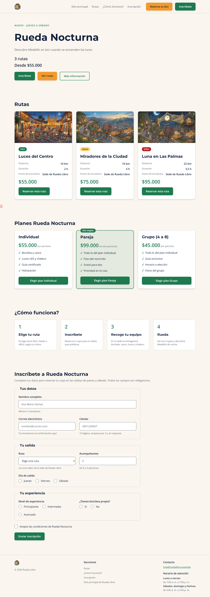
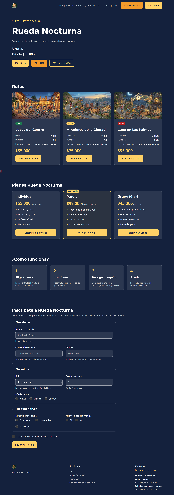

# Rueda Libre y Rueda Nocturna

Ecosistema web para **Rueda Libre**, un negocio de alquiler de bicicletas en Medellín, y su campaña de rutas nocturnas **Rueda Nocturna**. Está formado por dos productos enlazados entre sí:

- **Sitio Rueda Libre v2.0**: sitio de varias páginas construido con HTML, CSS propio y **Bootstrap 5**.
- **Landing Rueda Nocturna**: página de la campaña construida con **Tailwind CSS 4**, con identidad de marca, modo oscuro, planes, formulario de inscripción y diseño responsive.

Proyecto del módulo de maquetación de Riwi (Nodo Digital).

## Enlaces publicados

| Producto | URL |
|---|---|
| Sitio Rueda Libre v2.0 | https://christian-b1998.github.io/rueda-libre/ |
| Landing Rueda Nocturna | https://christian-b1998.github.io/rueda-libre/nocturna/ |
| Kit de componentes | https://christian-b1998.github.io/rueda-libre/nocturna/componentes.html |
| Repositorio | https://github.com/christian-b1998/rueda-libre |

Desde cualquier página del sitio se llega a la landing con un clic (menú "Rueda Nocturna" y cuarta diapositiva del carrusel), y desde la landing se vuelve al sitio (logo y enlace "Sitio principal") o se va a reservar una bicicleta (botón "Reserva tu bici").

## Páginas

| Archivo | Contenido |
|---|---|
| `index.html` | Inicio del sitio: carrusel, flota, rutas y beneficios |
| `paginas/tarifas.html` | Tarifas y rutas |
| `paginas/reservas.html` | Formulario de reserva con validación nativa |
| `nocturna/index.html` | Landing Rueda Nocturna: portada, rutas, planes, cómo funciona e inscripción |
| `nocturna/componentes.html` | Kit de componentes: botones, card, alertas y campos |
| `nocturna/prototipo.html` | Prototipo inicial hecho con el Play CDN de Tailwind |
| `pruebas/catalogo-bootstrap.html` | Primera prueba de la flota con la grilla de Bootstrap |

## Tecnologías

- HTML5 semántico y formularios con validación nativa (`required`, `minlength`, `pattern`, `min` y `max`).
- CSS propio con variables y Bootstrap 5.3 por CDN (sitio v2.0).
- Tailwind CSS 4 con la CLI (`@tailwindcss/cli`): `@theme` para los colores y fuentes de marca, variante `dark:`, prefijos responsive y tres clases con `@apply`.
- Google Fonts: Montserrat (títulos) y Open Sans (texto).
- Git y GitHub Pages.

### Cómo compilar el CSS de la landing

```bash
cd nocturna
npm install
npx @tailwindcss/cli -i ./src/input.css -o ./src/output.css --watch      # desarrollo
npx @tailwindcss/cli -i ./src/input.css -o ./src/output.css --minify     # versión que se publica
```

## Identidad de marca

Los mismos valores están en las variables del sitio (`css/styles.css`) y en el `@theme` de la landing (`nocturna/src/input.css`).

| Color | Código |
|---|---|
| Verde Ruta | `#1E7A4F` |
| Naranja Pedal | `#F39A2B` |
| Azul Noche | `#14213D` |
| Crema | `#FAF6EF` |
| Gris Asfalto | `#5B6470` |
| Amarillo Farol (campaña) | `#FFD166` |

## Capturas

| Sitio en escritorio | Landing en escritorio |
|---|---|
|  |  |

| Landing en celular (360 px) | Landing en modo oscuro |
|---|---|
|  |  |

## Recomendación de framework

Para la próxima versión de todo el sitio recomiendo **Tailwind CSS**. Las mediciones propias:

| Recurso | Transferido | Tamaño real |
|---|---|---|
| `output.css` de Tailwind (minificado) | 4,3 kB | 21,0 kB |
| `bootstrap.min.css` | 33,8 kB | 232 kB |
| `bootstrap.bundle.min.js` | 25,2 kB | 80,5 kB |

- **Tamaño:** el CSS de Tailwind pesa unas 15 veces menos que el CSS y el JavaScript de Bootstrap juntos.
- **Personalización:** los colores y fuentes de la marca se definen una vez en `@theme` y salen como utilidades; con Bootstrap hubo que sobrescribir variables `--bs-*` y resolver conflictos de cascada.
- **Costo:** la curva de aprendizaje es más larga y el HTML lleva más clases. Se compensa con clases `@apply` para el elemento que más se repite (los botones pasaron de 151 clases a 16) y reutilizando el marcado del kit.
- **Cuándo elegir Bootstrap:** cuando se necesiten componentes ya hechos (navbar, modales, formularios) con poco esfuerzo y un aspecto uniforme.

El análisis completo está en `bitacora.txt`.

## Cómo se construyó

| Reto | Qué aportó |
|---|---|
| 1. Prototipo con Play CDN | Portada de la campaña con utilidades |
| 2. Tailwind CLI y botones | Base técnica y tres variantes de botón |
| 3. Cards de rutas | Card de ruta con nivel por color y texto |
| 4. Kit de componentes | Alertas, campos y página de componentes |
| 5. Maquetación | Layout completo con flex y grid |
| 6. Responsive | Clases mobile-first con `sm:`, `md:` y `lg:` |
| 7. Marca y modo oscuro | `@theme` y variante `dark:` |
| 8. Legibilidad y veredicto | `@apply` en botones y comparativa Bootstrap vs Tailwind |
| Contrarreloj 1 | Formulario de inscripción validado |
| Contrarreloj 2 | Navbar, carrusel y landing integrados al sitio |
| Contrarreloj 3 | Sección de planes con box model, Flexbox y Grid |
| Lanzamiento | Validación, README, publicación y demo |

## Aprendizajes

- Bootstrap restablece estilos de elementos nativos (por ejemplo `fieldset`, `legend` y `caption`), y el orden de las hojas de estilo decide quién gana en la cascada.
- En Tailwind solo se generan las clases que aparecen en los archivos: hay que tener la CLI compilando, y la versión publicada debe generarse con `--minify` y sin `--watch` encima.
- Los colores de marca deben revisarse con el contraste de WCAG: Verde Ruta sobre Azul Noche da 3,01:1 y no cumple, así que en modo oscuro se usa Amarillo Farol (11,08:1).
- Un formulario con validación nativa y etiquetas asociadas funciona solo con el teclado y no necesita JavaScript para validar.
- Los archivos generados, como `output.css`, no se resuelven a mano en un conflicto de Git: se vuelven a generar.
- Las rutas relativas entre carpetas (`../index.html`, `nocturna/index.html`) cambian según desde dónde se enlace, y conviene comprobarlas en local y en GitHub Pages.

## Autor

Christian Camilo Benitez Gomez, estudiante de Riwi (Clan Tesla). GitHub: [@christian-b1998](https://github.com/christian-b1998).
